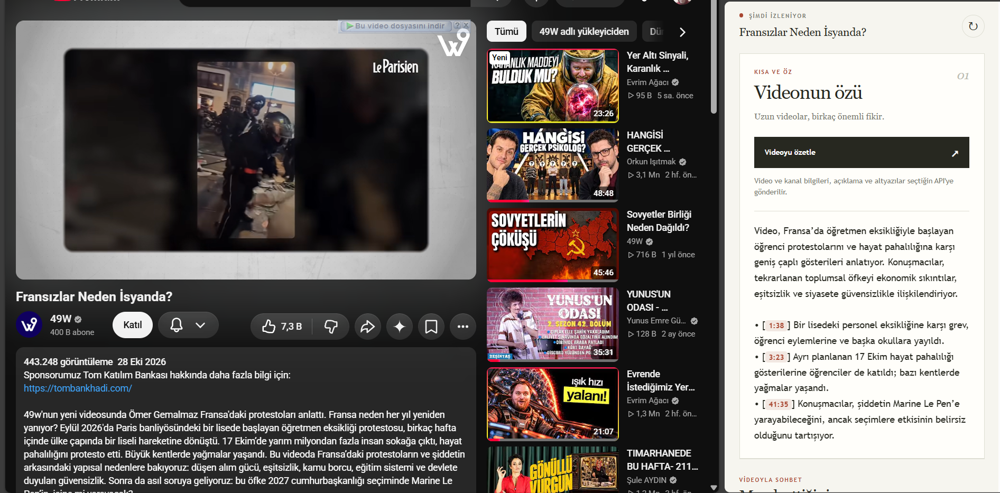
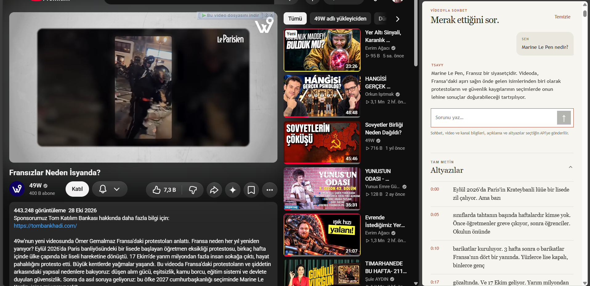
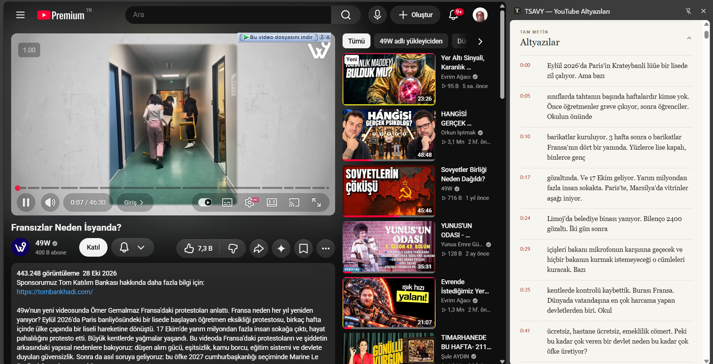

# TSAVY

**TSAVY** (Transcript Any Video on YouTube), YouTube videolarının erişilebilir konuşma metinlerini Chrome yan panelinde okumanı sağlar. İstersen kendi seçtiğin OpenAI uyumlu bir API ile videoyu özetleyebilir ve video hakkında sorular sorabilirsin.

TSAVY konuşmayı kendisi yazıya dökmez: YouTube'un sunduğu transkripti kullanır. Transkript görüntülemek için API anahtarı gerekmez.

## Özellikler

- YouTube transkriptini zaman damgalarıyla yan panelde görüntüleme.
- Video başlığı, kanal bilgileri, açıklama ve transkriptten kısa özet oluşturma.
- Video hakkında soru sorma; önceki mesajları bağlam olarak kullanma ve istendiğinde ayrıntılı yanıt alma.
- Özetteki geçerli zaman damgalarından videonun ilgili anına gitme.
- OpenAI uyumlu servis adresini ve modeli seçme; destekleniyorsa model listesini görüntüleme.
- Azaltılmış hareket tercihine uygun arayüz geçişleri.

## Ekran görüntüleri

**Video özeti** — YouTube videosunun yanında kısa özet ve transkriptteki zaman damgaları:

**Video hakkında sohbet** — Videoyla ilgili soru ve yanıt, altında transkript:

**Transkript** — YouTube videosunun konuşma metni zaman damgalarıyla:

## Gereksinimler

- Chrome 116 veya üzeri.
- YouTube'da erişilebilir transkripti olan bir video.
- Özet ve sohbet için OpenAI uyumlu bir API adresi ve model; sağlayıcı gerektiriyorsa API anahtarı. Yalnızca transkripti görüntülemek için API bağlantısı gerekmez.

## Kurulum

1. Bu depoyu bilgisayarına indir veya klonla.
2. Chrome'da `chrome://extensions` adresini aç ve **Geliştirici modu**nu etkinleştir.
3. **Paketlenmemiş öğe yükle** seçeneğine tıkla ve `manifest.json` dosyasını içeren depo klasörünü seç.
4. YouTube'da bir video açıp araç çubuğundaki TSAVY simgesine tıkla. Gerekirse simgeyi eklentiler menüsünden sabitle.

Depodaki dosyalar değiştiğinde `chrome://extensions` sayfasında TSAVY'yi yenile; ardından YouTube sayfasını yenileyip paneli tekrar aç.

## Kullanım

Panel etkin sekme veya video değiştiğinde transkripti yeniden yükler. Yenile düğmesiyle elle tekrar deneyebilirsin. **Altyazılar** bölümünü açarak tam metni görebilirsin. Eklenti YouTube'un konuşma metni panelini kendisi açarsa okuma sonrasında kapatır; önceden açık olan paneli açık bırakır.

### API bağlantısı

1. Panelde **API ayarları**nı aç.
2. OpenAI uyumlu temel adresi gir; örneğin `https://api.example.com/v1`. Sonuna `/chat/completions` ekleme.
3. Sağlayıcı gerektiriyorsa API anahtarını gir. Kimlik doğrulaması gerektirmeyen yerel sunucularda boş bırakılabilir.
4. **Listele** ile destekleniyorsa modelleri getirip seç veya model kimliğini elle gir. **Kaydet**e basıp Chrome'un ilgili adrese erişim iznini onayla.

Uzak API adreslerinde HTTPS gerekir; HTTP yalnızca `localhost`, `127.0.0.1` ve `[::1]` için kullanılabilir. API, `POST /chat/completions` ve model listesi için `GET /models` uçlarında OpenAI uyumlu JSON desteklemelidir. Model listesi alınamasa da model adı elle girilebilir.

### Özet ve sohbet

Transkript yüklendikten sonra **Videoyu özetle**ye basabilir veya **Merak ettiğini sor** alanından soru sorabilirsin. Sohbette Enter gönderir, Shift+Enter yeni satır ekler. Modelden varsayılan olarak kısa cevap istenir; daha ayrıntılı anlatmasını ayrıca isteyebilirsin. Yanıtların doğruluğu ve uzunluğu kullanılan modele bağlıdır.

Gönderilen soru hemen görünür; yanıt beklenirken durum göstergesi çıkar. İstek başarısız olursa soru yeniden denemen için giriş alanına döner. Özette yalnızca transkriptte bulunan zaman damgaları tıklanabilir; reklam sırasında videoda atlama yapılamaz.

Tamamlanan özetler panel açıkken sekme ve video bazında bellekte tutulur; aynı sekmeye dönünce yeniden gösterilir. Sohbet geçmişi aynı videonun transkripti yenilendiğinde korunur, başka sekme veya videoya geçildiğinde ya da **Temizle** seçildiğinde silinir. Panel kapatıldığında bellekteki özet ve sohbetler silinir.

## Gizlilik ve izinler

- Transkript yalnızca görüntülendiğinde bir yapay zekâ servisine gönderilmez. Özet veya sohbet isteğinde video başlığı ve bağlantısı, kanal adı ve bağlantısı, video açıklaması ve transkript seçilen API'ye gönderilir. Sohbette önceki başarılı soru ve yanıtlar da gönderilir. Sağlayıcının gizlilik politikasını incele.
- Video bağlantısı yalnızca video kimliğinden oluşturulur; URL'deki oynatma listesi gibi ek parametreler gönderilmez. Kanal bağlantısının sorgu ve parça bilgileri çıkarılır.
- API adresi, model ve anahtar Chrome'un yerel eklenti depolamasında **şifrelenmeden** saklanır. Cihaza veya tarayıcı profiline erişebilen kişiler anahtara erişebilir. **Bağlantıyı sil** kayıtlı bilgileri kaldırır.
- Eklenti, yan paneli açmak, etkin sekmeyi belirlemek, YouTube sayfasındaki transkripti okumak ve bağlantı ayarlarını saklamak için Chrome izinleri kullanır. Seçilen API adresine erişim izni ayrıca istenir.
- Transkript kalıcı olarak saklanmaz. Uzun videolar ve sohbetler modelin bağlam sınırını aşabilir; sağlayıcı kullanım ücreti uygulayabilir.

## Sınırlamalar

- Eklenti `www.youtube.com/watch` sayfalarında ve YouTube'un sağladığı seçili dildeki transkriptle çalışır. Transkripti olmayan ya da erişim sunulmayan videoları yazıya dökmez.
- Transkript düğmesi şu anda Türkçe ve İngilizce YouTube arayüzlerinde aranır. YouTube'un arayüzündeki değişiklikler metnin okunmasını etkileyebilir.
- Otomatik altyazılar, video açıklamaları ve yapay zekâ yanıtları hatalı veya eksik olabilir. Önemli bilgileri videodan ve güvenilir kaynaklardan doğrula.

## Sorun giderme

| Durum | Kontrol |
| --- | --- |
| Transkript bulunamıyor | Videonun YouTube'da konuşma metni sunduğunu ve arayüz dilinin Türkçe veya İngilizce olduğunu kontrol et. Sayfayı yenileyip panelde tekrar dene. |
| Model listesi alınamıyor | API adresini ve gerekiyorsa anahtarı kontrol et. Sağlayıcı listeleme uç noktasını desteklemiyorsa model kimliğini elle gir. |
| Özet veya sohbet yanıtı gelmiyor | API adresini, modeli ve erişim iznini kontrol et. Uzun transkriptler veya sohbetler modelin bağlam sınırını aşabilir. |

## Proje yapısı

| Dosya | Görev |
| --- | --- |
| `manifest.json`, `background.js` | Chrome eklenti izinleri ve yan panelin açılması |
| `panel.html`, `panel.css`, `panel.js` | Panel arayüzü ve YouTube transkriptinin okunması |
| `ai.js` | API bağlantısı, ayarlar ve özetleme |
| `chat.js`, `chat.css`, `chat-motion.css` | Sohbet akışı, görünümü ve geçişleri |
| `disclosure.css`, `icons/` | Açılır bölüm stilleri ve eklenti simgeleri |

## Lisans

[MIT Lisansı](LICENSE). YouTube, Google LLC'nin markasıdır; TSAVY YouTube veya Google tarafından sunulmaz ya da desteklenmez.
